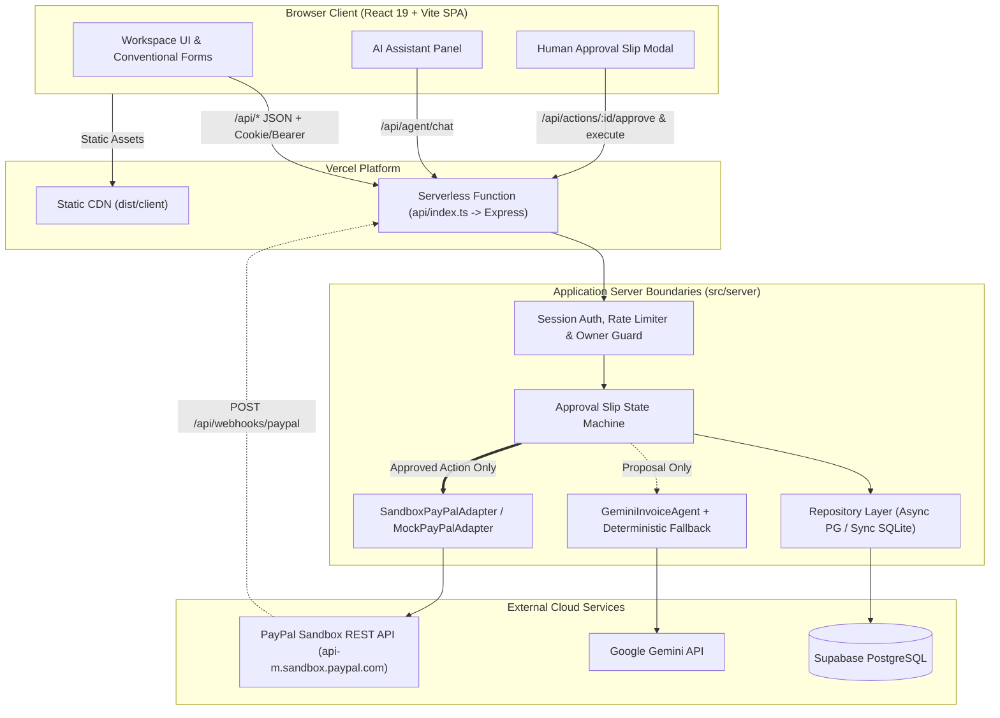

# InvoicePilot

> **AI-Assisted Invoicing & Human-Approved Payment Workspace for Freelancers & Consultants**
> *Built for the PayPal AI Hackathon — Build What's Next with PayPal and AI.*

[](https://invoicepilot-beryl.vercel.app)
[](https://github.com/KhaleelxRahman/InvoicePilot)
[](LICENSE)
[](tests/e2e)
[](tests/unit)
[](https://www.typescriptlang.org/)
[](https://supabase.com/)

---

## Table of Contents

- [InvoicePilot](#invoicepilot)
  - [Table of Contents](#table-of-contents)
  - [1. Project Overview](#1-project-overview)
  - [2. Verified Product Features](#2-verified-product-features)
  - [3. Technology Stack](#3-technology-stack)
  - [4. Architecture Overview](#4-architecture-overview)
  - [5. Directory Structure](#5-directory-structure)
  - [6. Prerequisites](#6-prerequisites)
  - [7. Local Windows / PowerShell Setup](#7-local-windows--powershell-setup)
  - [8. Installation \& Development Commands](#8-installation--development-commands)
  - [9. Environment Variables Reference](#9-environment-variables-reference)
  - [10. SQLite Local Development](#10-sqlite-local-development)
  - [11. Supabase Production Database Setup](#11-supabase-production-database-setup)
  - [12. Database Migration Safety](#12-database-migration-safety)
  - [13. PayPal Sandbox Configuration](#13-paypal-sandbox-configuration)
  - [14. PayPal Webhook Setup](#14-paypal-webhook-setup)
  - [15. Gemini AI Configuration \& Fallback](#15-gemini-ai-configuration--fallback)
  - [16. Testing Commands \& Verification](#16-testing-commands--verification)
  - [17. Production Build](#17-production-build)
  - [18. Vercel Deployment](#18-vercel-deployment)
  - [19. Health-Check Verification](#19-health-check-verification)
  - [20. Troubleshooting](#20-troubleshooting)
  - [21. Security Guidelines](#21-security-guidelines)
  - [22. Known Limitations \& Non-Goals](#22-known-limitations--non-goals)
  - [23. Documentation Index \& License](#23-documentation-index--license)

---

## 1. Project Overview

Independent freelancers, consultants, and small service businesses lose hours each week to manual invoice drafting, fractional tax calculations, awkward overdue payment follow-ups, and fragmented payment reconciliation. At the same time, autonomous AI agents that send invoices or trigger payment requests without human review create unacceptable financial and reputational risk.

**InvoicePilot** solves this with a strict architectural invariant: **AI prepares; the Human authorizes; PayPal Sandbox transacts.**

- **Target Hosting**: Vercel (`https://invoicepilot-beryl.vercel.app`)
- **Cloud Database**: Supabase PostgreSQL (`pg.Pool` via transaction pooler)
- **Local Development Database**: Built-in Node.js SQLite (`node:sqlite` / `DatabaseSync`)
- **Payment Provider**: PayPal Invoicing v2 REST API (Sandbox Mode & Isolated Mock Mode)
- **AI Assistant**: Google Gemini (`gemini-3.8-flash`) with deterministic parser and conventional form fallbacks

---

## 2. Verified Product Features

| Capability | Implementation & Verification |
| :--- | :--- |
| **Authentication & Session Isolation** | `crypto.scryptSync` password hashing, timing-safe verification, SHA-256 hashed session tokens in `sessions`, `HttpOnly; SameSite=Lax; Secure` cookies, and strict per-owner IDOR protection on every query. |
| **4-Step Onboarding & Demo Workspace** | Guided workspace setup (business profile, currency/cap defaults, first client, sandbox check) plus an isolated synthetic demo tenant (`usr_demo_tenant_01`) that never touches real user accounts. |
| **Client & Invoice CRUD** | Full client directory, multi-line-item invoice drafting, reusable line-item templates (`/api/templates`), integer minor-unit math (`subtotalMinor + taxMinor = totalMinor`), and ISO calendar date validation. |
| **Human Approval Gate State Machine** | Server-enforced state machine (`DRAFTED -> PENDING_APPROVAL -> APPROVED -> EXECUTING -> EXECUTED`, plus `REJECTED`, `EXPIRED`, `FAILED`, `CANCELLED`). Generates a cryptographic `payloadHash` on the Approval Slip and blocks any unapproved or stale execution. |
| **Constrained Gemini AI Assistant** | Natural-language invoice drafting (`/api/agent/chat`), stored-client resolution (never invents clients), prompt-injection sanitization, and automatic fallback when `GEMINI_API_KEY` is unconfigured or unreachable. |
| **PayPal Sandbox Invoicing v2** | OAuth 2.0 client credentials exchange, draft creation (`POST /v2/invoicing/invoices`), send dispatch (`POST /v2/invoicing/invoices/{id}/send`), status refresh (`GET /v2/invoicing/invoices/{id}`), and timeout reconciliation. |
| **Webhook Signature Verification** | Verifies `paypal-transmission-*` headers against PayPal's `/v1/notifications/verify-webhook-signature` endpoint (`PAYPAL_WEBHOOK_ID`), deduplicates replays via `webhook_events`, and maps `PAID`, `CANCELLED`, `REFUNDED`, and `SENT`. |
| **Client-Aware Reminders** | Generates overdue payment reminders (`polite`, `firm`, `final` tones) grounded in client history, subject to the human approval state machine and scheduled delivery processing (`/api/reminders/process-scheduled`). |
| **Grounded Financial Insights & PDF Export** | Aging buckets, collection rate, client reliability metrics (`/api/insights`), partial payment recording, operational completion tracking, and server-generated PDF invoice downloads (`/api/invoices/:id/pdf`). |

---

## 3. Technology Stack

| Layer | Technology | Role |
| :--- | :--- | :--- |
| **Frontend** | React 19, TypeScript 5.7, Vite 6 | Single-page application compiled to `dist/client` |
| **Design System** | CSS Custom Properties (Impeccable UI) | Responsive layout (`360px`–`1440px`), dark/light theme, accessible forms |
| **Backend API** | Node.js 22 / 24, Express 4.21, Zod 4 | REST API, validation, approval state machine, PDF generation |
| **Serverless Runtime** | Vercel Functions (`api/index.ts`) | Serverless Express entry point with `vercel.json` routing |
| **Production Database** | Supabase PostgreSQL (`pg` 8.23) | Cloud relational persistence with `AsyncLocalStorage` transactions |
| **Local Database** | `node:sqlite` (`DatabaseSync`) | Zero-configuration local development and unit/E2E testing |
| **Payments** | PayPal Invoicing v2 REST API (Sandbox) | Draft creation, invoice dispatch, status sync, webhook verification |
| **AI Engine** | Google Gemini REST API (`gemini-3.8-flash`) | Structured invoice & reminder drafting with deterministic fallback |
| **Testing** | Vitest 4.1, Supertest 7, Playwright 1.50 | 141 unit/integration tests + 36 browser E2E tests |

---

## 4. Architecture Overview



See [docs/ARCHITECTURE.md](docs/ARCHITECTURE.md) for detailed component boundaries and sequence diagrams.

---

## 5. Directory Structure

```text
InvoicePilot/
├── api/
│   └── index.ts                  # Vercel Node.js serverless function entry point
├── docs/                         # Architecture, deployment, API, security & QA specifications
│   ├── ARCHITECTURE.md
│   ├── DEPLOYMENT.md
│   ├── ENVIRONMENT_VARIABLES.md
│   └── LOCAL_DEVELOPMENT.md
├── migrations/                   # Idempotent Supabase PostgreSQL SQL migrations
│   ├── 001_initial_supabase_schema.sql
│   ├── 002_invoice_completed_flag.sql
│   └── 003_add_refunded_provider_status.sql
├── netlify/
│   └── functions/api.ts          # Historical Netlify serverless wrapper (preserved)
├── scripts/                      # Standalone CLI verification utilities
│   ├── verifyGeminiCli.ts
│   └── verifyWebhookHandling.ts
├── src/
│   ├── client/                   # React 19 frontend SPA
│   │   ├── App.tsx
│   │   ├── main.tsx
│   │   └── styles.css
│   └── server/                   # Express backend & domain logic
│       ├── agent/geminiAgent.ts  # Gemini AI integration & deterministic fallback
│       ├── db/                   # SQLite & PostgreSQL repositories, schema, migrations
│       ├── paypal/               # PayPal Sandbox & Mock adapters + CLI verifiers
│       ├── pdf/                  # Server-side PDF invoice generator
│       ├── app.ts                # Express API routes, security headers, CORS, rate limits
│       ├── config.ts             # Validated environment configuration loader
│       ├── dev.ts                # Local development server (Vite middleware + Express)
│       └── index.ts              # Standalone production Node server entry point
├── tests/
│   ├── e2e/                      # 13 Playwright E2E spec files (Desktop & Mobile)
│   └── unit/                     # 20 Vitest unit & integration test suites (141 tests)
├── .env.example                  # Safe environment variable template (no secrets)
├── package.json                  # Scripts and dependencies
├── playwright.config.ts          # Playwright E2E configuration
├── tsconfig.json                 # TypeScript configuration
├── tsconfig.server.json          # Server build TypeScript configuration
├── vercel.json                   # Vercel build, rewrites, function & security headers config
└── vite.config.ts                # Vite frontend bundling configuration
```

---

## 6. Prerequisites

- **Operating System**: Windows 11 (PowerShell 5.1 / 7+), macOS, or Linux
- **Node.js**: `v22.13.0+` or `v24.x` (verified on `v24.22.1` — includes built-in `node:sqlite` for local development)
- **npm**: `v10.0.0+`
- **Optional External Accounts**:
  - **Supabase**: PostgreSQL database for cloud/production persistence
  - **PayPal Developer Account**: Sandbox REST API app credentials (`Client ID`, `Secret`, `Webhook ID`)
  - **Google AI Studio**: `GEMINI_API_KEY` for live Gemini model inference (optional)

---

## 7. Local Windows / PowerShell Setup

Open PowerShell in your workspace directory and run:

```powershell
# 1. Verify Node.js version (22.13+ or 24.x)
node -v
npm -v

# 2. Install dependencies
npm install

# 3. Copy the environment template to .env (if .env does not already exist)
if (-not (Test-Path .env)) { Copy-Item .env.example .env }

# 4. Initialize and migrate the local SQLite database
npm run db:migrate

# 5. Start the local full-stack development server
npm run dev
```

The development server starts on **`http://localhost:3000`** with hot reload for the React client and Express API routes. See [docs/LOCAL_DEVELOPMENT.md](docs/LOCAL_DEVELOPMENT.md) for full Windows/PowerShell tips.

---

## 8. Installation & Development Commands

All scripts defined in [package.json](package.json):

| Command | Description |
| :--- | :--- |
| `npm run dev` | Starts the unified Express + Vite development server (`tsx src/server/dev.ts`) on `http://localhost:3000` |
| `npm run build` | Builds the React SPA (`dist/client`) and compiles server TypeScript (`dist/server`) |
| `npm start` | Runs the compiled standalone Node production server (`node dist/server/index.js`) |
| `npm run typecheck` | Runs `tsc --noEmit` across the codebase |
| `npm test` | Runs the complete Vitest unit and integration test suite (`vitest run`) |
| `npm run test:e2e` | Runs the Playwright end-to-end browser test suite (`playwright test`) |
| `npm run db:migrate` | Runs local SQLite schema migrations (`tsx src/server/db/migrateAndSeedCli.ts migrate`) |
| `npm run db:seed:demo` | Resets and seeds the isolated local synthetic demo tenant (`usr_demo_tenant_01`) |
| `npm run db:migrate:supabase` | Applies idempotent PostgreSQL migrations (`001`–`004`) to `DATABASE_URL` using verified TLS |
| `npm run paypal:adapter:verify` | Verifies Mock and Sandbox PayPal adapter invariants via CLI |
| `npm run paypal:sandbox:verify` | Verifies live PayPal Sandbox OAuth and draft invoice creation via CLI |

---

## 9. Environment Variables Reference

The server loads configuration exclusively through [`loadAppConfig()`](src/server/config.ts) and rate-limit configuration in [`createApiApp()`](src/server/app.ts).

| Variable | Required? | Secret? | Default | Description |
| :--- | :---: | :---: | :--- | :--- |
| `APP_ENV` | Yes (Prod) | No | `development` | `development` \| `test` \| `production`. Enables `Secure` cookies, HSTS, and strict CORS in `production`. |
| `APP_BASE_URL` | Yes (Prod) | No | `http://localhost:3000` | Canonical application origin (e.g. `https://invoicepilot-beryl.vercel.app`). |
| `DATABASE_URL` | Yes (Prod) | **Yes** | `data/invoicepilot.db` *(local only)* | Supabase PostgreSQL URL (`postgresql://...`) in production; leave empty locally to use SQLite. |
| `PAYPAL_MODE` | Yes | No | `sandbox` | `sandbox` or `mock`. Live money mode is rejected at startup. |
| `PAYPAL_CLIENT_ID` | For Sandbox | **Yes** | `""` | PayPal Sandbox REST API Client ID. |
| `PAYPAL_CLIENT_SECRET` | For Sandbox | **Yes** | `""` | PayPal Sandbox REST API Client Secret. |
| `PAYPAL_WEBHOOK_ID` | For Webhooks | **Yes** | `""` | PayPal Sandbox Webhook ID for `/api/webhooks/paypal` signature verification. |
| `GEMINI_API_KEY` | Optional | **Yes** | `""` | Google Gemini API key. Uses deterministic fallback when empty. |
| `GEMINI_MODEL` | Optional | No | `gemini-3.8-flash` | Gemini model name (automatically normalizes legacy `gemini-2.5-flash` / `gemini-1.5-flash` to `gemini-3.8-flash`). |
| `GEMINI_TIMEOUT_MS` | Optional | No | `15000` | Timeout in ms for Gemini requests (`>= 100`). |
| `PAYPAL_TIMEOUT_MS` | Optional | No | `15000` | Timeout in ms for PayPal Sandbox HTTP requests (`>= 100`). |
| `PAYPAL_SANDBOX_INVOICER_EMAIL` | Optional | No | `undefined` | Optional Sandbox merchant invoicer email override. |
| `PAYPAL_SANDBOX_RECIPIENT_EMAIL` | Optional | No | `sb-buyer-invoicepilot@personal.example.com` | Default recipient email for CLI sandbox checks. |
| `AUTH_PROVIDER` | Optional | No | `session` | Authentication strategy label. |
| `PORT` | Optional | No | `3000` | HTTP port for local/standalone server. |
| `RATE_LIMIT_LOGIN_MAX` | Optional | No | `20` (`100` in test) | Max requests per minute per IP on `/api/auth/login`. |
| `RATE_LIMIT_REGISTER_MAX` | Optional | No | `20` (`100` in test) | Max requests per minute per IP on `/api/auth/register`. |
| `RATE_LIMIT_AGENT_MAX` | Optional | No | `30` (`100` in test) | Max requests per minute per IP on `/api/agent/chat`. |

See [docs/ENVIRONMENT_VARIABLES.md](docs/ENVIRONMENT_VARIABLES.md) for scope-by-scope (`Production`, `Preview`, `Development`, and local `.env`) guidance.

---

## 10. SQLite Local Development

- When `DATABASE_URL` is unset in local development (`APP_ENV=development`), InvoicePilot automatically uses Node's built-in `node:sqlite` (`DatabaseSync`) with WAL mode enabled at `data/invoicepilot.db` (or `data/invoicepilot.test.db` when `APP_ENV=test`).
- **Serverless Safeguard**: When `process.env.VERCEL` or `process.env.NETLIFY` is present, local SQLite file fallback is strictly disabled (`defaultDbPath = ''`). If `DATABASE_URL` is missing in serverless production, database routes return `503 DATABASE_CONFIGURATION_REQUIRED` instead of attempting filesystem writes.

---

## 11. Supabase Production Database Setup

1. Create a Supabase project and copy the **Transaction Pooler** connection string (Port `6543`) from **Project Settings → Database → Connection string → URI**.
2. Configure `DATABASE_URL` in Vercel Environment Variables (`Production` and, if desired, `Preview`).
3. **Connection Pooling & TLS**: [`PostgresPoolAdapter`](src/server/db/postgresPoolAdapter.ts) configures `pg.Pool` (`max: 10`, `idleTimeoutMillis: 30000`, `connectionTimeoutMillis: 5000`) with `AsyncLocalStorage` transaction isolation and serverless-compatible TLS (`buildPostgresSslConfig`). Custom CA certificates can also be supplied via `SUPABASE_SSL_CA` or `DATABASE_SSL_CA`.

---

## 12. Database Migration Safety

All PostgreSQL migrations in [`migrations/`](migrations/) are non-destructive and idempotent:
- [`001_initial_supabase_schema.sql`](migrations/001_initial_supabase_schema.sql): Uses `CREATE TABLE IF NOT EXISTS`, `CREATE INDEX IF NOT EXISTS`, and `ON CONFLICT DO NOTHING` for the synthetic demo tenant seed.
- [`002_invoice_completed_flag.sql`](migrations/002_invoice_completed_flag.sql): Uses `ALTER TABLE invoices ADD COLUMN IF NOT EXISTS`.
- [`003_add_refunded_provider_status.sql`](migrations/003_add_refunded_provider_status.sql): Safely updates `invoices_provider_status_check` to include `'REFUNDED'` without modifying table rows.

To apply migrations to a configured `DATABASE_URL`:
```powershell
npm run db:migrate:supabase
```

---

## 13. PayPal Sandbox Configuration

1. Log in to the [PayPal Developer Dashboard](https://developer.paypal.com/dashboard/applications/sandbox) and create or select a **Sandbox REST API App**.
2. Set `PAYPAL_MODE=sandbox`, `PAYPAL_CLIENT_ID`, and `PAYPAL_CLIENT_SECRET` in your environment.
3. Verify OAuth 2.0 connectivity and draft creation safely from PowerShell:
   ```powershell
   npm run paypal:sandbox:verify
   ```
4. **Safety Invariant**: Live PayPal mode is rejected by `PayPalModeSchema` (`z.enum(['sandbox', 'mock'])`). Invoices are never dispatched to PayPal without an `APPROVED` slip in `pending_actions`.

---

## 14. PayPal Webhook Setup

1. In your PayPal Developer Sandbox App settings, add a **Webhook** with the listener URL:
   ```text
   https://invoicepilot-beryl.vercel.app/api/webhooks/paypal
   ```
2. Subscribe to the following Invoicing v2 events supported by [`src/server/app.ts`](src/server/app.ts):
   - `INVOICING.INVOICE.PAID`
   - `INVOICING.INVOICE.CANCELLED`
   - `INVOICING.INVOICE.REFUNDED`
   - `INVOICING.INVOICE.SENT`
   - `INVOICING.INVOICE.CREATED`
   - `INVOICING.INVOICE.UPDATED`
   - `INVOICING.INVOICE.SCHEDULED`
3. Copy the generated **Webhook ID** from PayPal and set it as `PAYPAL_WEBHOOK_ID` in Vercel.
4. **Verification Behavior**: Every inbound `POST /api/webhooks/paypal` request requires `paypal-transmission-id`, `paypal-transmission-time`, `paypal-transmission-sig`, `paypal-cert-url`, `paypal-auth-algo`, and `PAYPAL_WEBHOOK_ID`. Unverified payloads are rejected with `400 WEBHOOK_SIGNATURE_INVALID` and recorded as `REJECTED` / `IGNORED` in `webhook_events`.
5. Run the standalone webhook verification script locally at any time:
   ```powershell
   npx tsx scripts/verifyWebhookHandling.ts
   ```

---

## 15. Gemini AI Configuration & Fallback

- **Configured Mode**: When `GEMINI_API_KEY` is provided, [`GeminiInvoiceAgent`](src/server/agent/geminiAgent.ts) calls `gemini-3.8-flash` (`GEMINI_MODEL`) with a 15-second timeout (`GEMINI_TIMEOUT_MS`), validates structured outputs with Zod, resolves client names against the authenticated owner's stored clients, and neutralizes prompt-injection patterns in notes.
- **Unconfigured / Offline Fallback**: `GEMINI_API_KEY` is optional. When omitted or when the API times out or returns a `429`/`5xx` error, InvoicePilot automatically falls back to its built-in deterministic natural-language parser and preserves full conventional invoice and reminder forms.
- Verify Gemini and fallback behavior locally:
  ```powershell
  npx tsx scripts/verifyGeminiCli.ts
  ```

---

## 16. Testing Commands & Verification

Run the full quality gate locally in PowerShell:

```powershell
# 1. TypeScript static typecheck
npm run typecheck

# 2. Unit & integration test suite (20 test files, 141 tests)
npm test

# 3. Production client + server build
npm run build

# 4. Playwright end-to-end suite (13 spec files, 36 tests across Desktop & Mobile)
npm run test:e2e
```

---

## 17. Production Build

`npm run build` executes two steps:
1. `vite build`: Bundles the React 19 SPA into `dist/client/` (`dist/client/index.html` and hashed CSS/JS assets).
2. `tsc -p tsconfig.server.json`: Compiles the NodeNext server TypeScript files from `src/server/` into `dist/server/`.

---

## 18. Vercel Deployment

InvoicePilot is configured for Vercel via [`api/index.ts`](api/index.ts) and [`vercel.json`](vercel.json):

```powershell
# 1. Verify Vercel CLI authentication & linked project
npx vercel whoami
npx vercel env ls

# 2. Deploy to Preview
npx vercel

# 3. Deploy to Production (after preflight verification)
npx vercel --prod
```

See [docs/DEPLOYMENT.md](docs/DEPLOYMENT.md) for the complete Vercel deployment and rollback runbook.

---

## 19. Health-Check Verification

After starting the server or deploying to Vercel, query `/api/health`:

```powershell
Invoke-RestMethod -Uri "https://invoicepilot-beryl.vercel.app/api/health" | ConvertTo-Json
```

Expected healthy production response:
```json
{
  "status": "ok",
  "service": "invoicepilot",
  "stage": "stage-09-auth-onboarding",
  "environment": "production",
  "authProvider": "session",
  "paypalMode": "sandbox",
  "isMock": false,
  "modeLabel": "PayPal Sandbox Mode (No Live Money)",
  "adapterStatusLabel": "PayPal Sandbox Mode (Live Sandbox API — No Real Money)",
  "sandboxCredentialsConfigured": true,
  "webhookConfigured": true,
  "geminiConfigured": false,
  "geminiModel": "gemini-3.8-flash",
  "databaseEngine": "postgresql-supabase",
  "databaseConfigured": true,
  "schemaVersion": 6,
  "approvalGateEnforced": true
}
```

---

## 20. Troubleshooting

| Symptom / Error | Cause | Resolution |
| :--- | :--- | :--- |
| `503 DATABASE_CONFIGURATION_REQUIRED` | `DATABASE_URL` is missing in a serverless environment (`VERCEL=1` or `NETLIFY=true`). | Configure `DATABASE_URL` with your Supabase PostgreSQL URI in Vercel Environment Variables and redeploy. |
| `401 invalid_client` on PayPal OAuth | `PAYPAL_CLIENT_ID` or `PAYPAL_CLIENT_SECRET` has extra quotes, whitespace, or belongs to a deleted Sandbox app. | Re-copy the exact Client ID and Secret from the PayPal Developer Sandbox dashboard into Vercel and redeploy. |
| `400 WEBHOOK_SIGNATURE_INVALID` | Missing `PAYPAL_WEBHOOK_ID` or unverified `paypal-transmission-*` headers. | Set `PAYPAL_WEBHOOK_ID` to the ID shown in PayPal Developer Dashboard for `https://invoicepilot-beryl.vercel.app/api/webhooks/paypal`. |
| `403 Forbidden` on `OPTIONS /api/*` | Request `Origin` header does not match `APP_BASE_URL` or the Vercel deployment URL. | Set `APP_BASE_URL=https://invoicepilot-beryl.vercel.app` in Vercel Production environment variables. |
| `429 RATE_LIMITED` | Exceeded per-IP rate limit on `/api/auth/login` (20/min), `/api/auth/register` (20/min), or `/api/agent/chat` (30/min). | Wait for the `Retry-After` window to elapse or adjust `RATE_LIMIT_*_MAX` in non-production testing. |

---

## 21. Security Guidelines

- **Zero Client-Side Secrets**: Never prefix `PAYPAL_CLIENT_SECRET`, `DATABASE_URL`, `PAYPAL_WEBHOOK_ID`, or `GEMINI_API_KEY` with `VITE_`. All secrets remain strictly server-side.
- **Git Secret Hygiene**: `.env`, `.env.*`, `.env.local`, and `.vercel` are ignored via [`.gitignore`](.gitignore). Never commit real credentials.
- **Defense-in-Depth Headers**: Every response includes `Content-Security-Policy`, `Strict-Transport-Security` (in production), `X-Frame-Options: DENY`, `X-Content-Type-Options: nosniff`, `Referrer-Policy`, and `Permissions-Policy`.
- **Fail-Closed Authorization**: All `/api/clients`, `/api/invoices`, `/api/actions`, `/api/reminders`, `/api/insights`, `/api/templates`, and `/api/settings` routes require a valid session token and verify `owner_user_id` ownership before reading or mutating records.

---

## 22. Known Limitations & Non-Goals

- **Sandbox Only (MVP Non-Goal)**: Live money processing (`PAYPAL_MODE=live`) is intentionally disabled.
- **Distributed & Fail-Safe Rate Limiting**: `createInMemoryRateLimiter` shares rate-limit counters across serverless instances via the `rate_limits` database table (`InvoicePilotRepository.consumeRateLimit` / `AsyncInvoicePilotRepository.consumeRateLimit`) when `rate_limits` is migrated, and automatically falls back to per-isolate in-memory rate limiting if the database table is not yet migrated or temporarily unreachable (never failing open).
- **Scheduled Reminders Trigger**: Due scheduled reminders are dispatched when `POST /api/reminders/process-scheduled` is invoked (via UI or external cron trigger) rather than an always-on background worker process.

---

## 23. Documentation Index & License

- **Architecture & Boundaries**: [docs/ARCHITECTURE.md](docs/ARCHITECTURE.md)
- **Vercel Deployment Runbook**: [docs/DEPLOYMENT.md](docs/DEPLOYMENT.md)
- **Environment Variables Guide**: [docs/ENVIRONMENT_VARIABLES.md](docs/ENVIRONMENT_VARIABLES.md)
- **Local Development Guide**: [docs/LOCAL_DEVELOPMENT.md](docs/LOCAL_DEVELOPMENT.md)
- **API Contracts**: [docs/API.md](docs/API.md)
- **Database Schema**: [docs/DATABASE.md](docs/DATABASE.md)
- **PayPal Integration**: [docs/PAYPAL_INTEGRATION.md](docs/PAYPAL_INTEGRATION.md)
- **Security & Auth**: [docs/AUTH_SECURITY.md](docs/AUTH_SECURITY.md)

Licensed under the **MIT License** — see [LICENSE](LICENSE) for details.
