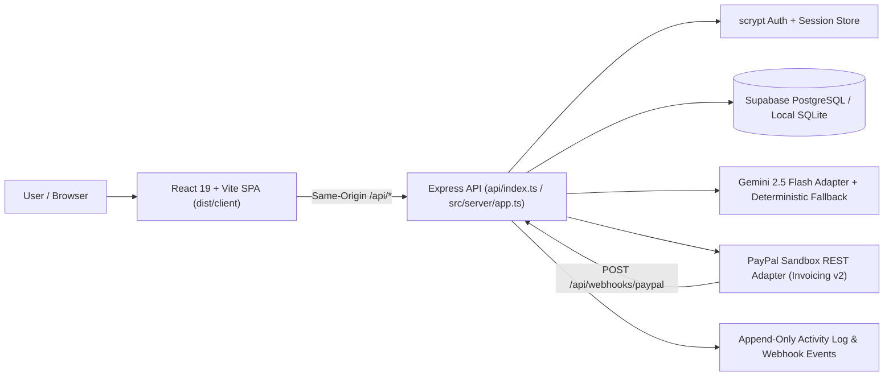
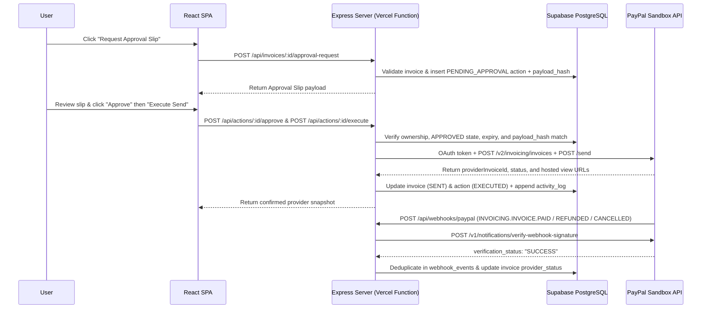

# InvoicePilot Architecture

## 1. Status & Implementation Baseline
This document describes the verified, implemented architecture of InvoicePilot across the React 19 SPA (`src/client/`), Express 4 API server (`src/server/`), Vercel serverless entry point (`api/index.ts`), and dual database layer (`AsyncInvoicePilotRepository` for Supabase PostgreSQL and `InvoicePilotRepository` for local SQLite).

## 2. High-Level System Boundaries

## 3. Component Responsibilities & Trust Boundaries

### Frontend (`src/client/App.tsx`, `src/client/main.tsx`, `src/client/styles.css`)
- Renders workspace dashboards, client and invoice CRUD forms, paper invoice previews, AI chat assistant, Approval Slip modal, reminders manager, grounded financial insights, and settings.
- Sends session credentials via `invoicepilot_session` (`HttpOnly` cookie) and `x-session-token` / `Authorization: Bearer` headers.
- **Trust Boundary**: Contains zero provider secrets (`PAYPAL_CLIENT_SECRET`, `GEMINI_API_KEY`, `DATABASE_URL`). Client-side calculations are display-only; the server recalculates and validates all monetary amounts.

### Serverless & Standalone Entry Points
- **Vercel Serverless (`api/index.ts` + `vercel.json`)**: Flags `process.env.VERCEL = '1'`, loads validated configuration via `loadAppConfig()`, and exports the singleton Express app created by `createApp(config)`. Static assets in `dist/client` are served by Vercel's CDN, with `/api/*` rewritten to `/api/index` and non-API routes rewritten to `/index.html`.
- **Standalone Node Server (`src/server/index.ts`)**: Mounts `createApiApp(config)` and serves `dist/client` directly on `config.port` (`npm start`).
- **Local Dev Server (`src/server/dev.ts`)**: Combines `createApiApp(config)` with Vite's development middleware on `http://localhost:3000` (`npm run dev`).

### Application Server (`src/server/app.ts`, `src/server/config.ts`)
- **Security Headers & CSP**: Emits `X-Content-Type-Options: nosniff`, `X-Frame-Options: DENY`, `Referrer-Policy: strict-origin-when-cross-origin`, `Permissions-Policy`, `Content-Security-Policy`, and (in production) `Strict-Transport-Security`.
- **CORS Allowlist**: Validates `Origin` against an exact allowlist (`config.appBaseUrl`, `https://invoicepilot-beryl.vercel.app`, dynamic `VERCEL_URL`, and in non-production `localhost:3000`/`5173`). Disallowed `OPTIONS` preflights fail with `403`.
- **Rate Limiting**: Protects `/api/auth/login`, `/api/auth/register`, and `/api/agent/chat` using `req.ip` behind `app.set('trust proxy', 1)`, backed by the shared `rate_limits` database table across serverless instances with automatic fail-safe fallback to in-memory counters.
- **Owner Isolation (`requireOwner`)**: Resolves the session token against the `sessions` table and scopes every read and write by `owner_user_id`. Rejects legacy `x-session-user-id` bypass headers with `401 UNAUTHORIZED`.
- **Money & Math Integrity**: Represents all currency values in integer minor units (`subtotal_minor`, `tax_minor`, `total_minor`, `paid_amount_minor`) with explicit ISO 4217 currency exponents (`CURRENCY_EXPONENTS`).

### Human Approval Gate State Machine (`pending_actions`)
- Consequential operations (`SEND_INVOICE`, `SEND_REMINDER`) cannot execute directly from user forms or AI tool calls.
- **State Transitions**:
  - `DRAFTED` / `PENDING_APPROVAL` → created with a canonical SHA-256 `payload_hash` and 30-minute `expires_at`.
  - `APPROVED` → requires explicit user confirmation (`POST /api/actions/:id/approve`).
  - `EXECUTING` → `EXECUTED` or `FAILED` (`POST /api/actions/:id/execute` or `POST /api/invoices/:id/paypal/send`).
  - If the underlying invoice is edited after slip creation, or if `expires_at` elapses, execution is blocked and the slip transitions to `EXPIRED` / `CANCELLED`.

### Database Layer (`src/server/db/`)
- **`PostgresPoolAdapter` (`src/server/db/postgresPoolAdapter.ts`)**: Wraps `pg.Pool` (`max: 10`), translates `?` placeholders to `$1..$n`, converts `BIGINT` (OID 20) to safe JavaScript numbers, and scopes transactions per async call stack using `AsyncLocalStorage` (supporting nested transactions via `SAVEPOINT`).
- **`AsyncInvoicePilotRepository` (`src/server/db/asyncRepository.ts`)**: Full asynchronous repository used when `DATABASE_URL` is a PostgreSQL connection string.
- **`InvoicePilotRepository` (`src/server/db/repository.ts`)**: Synchronous SQLite repository used for local development and fast unit tests.

## 4. Critical Sequence: Approved Invoice Dispatch & Webhook Sync

