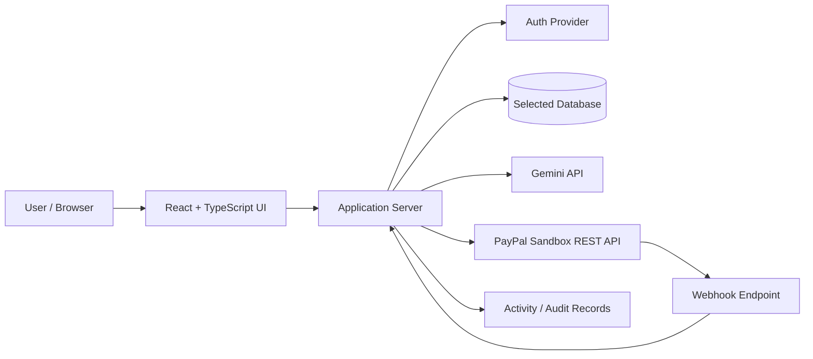
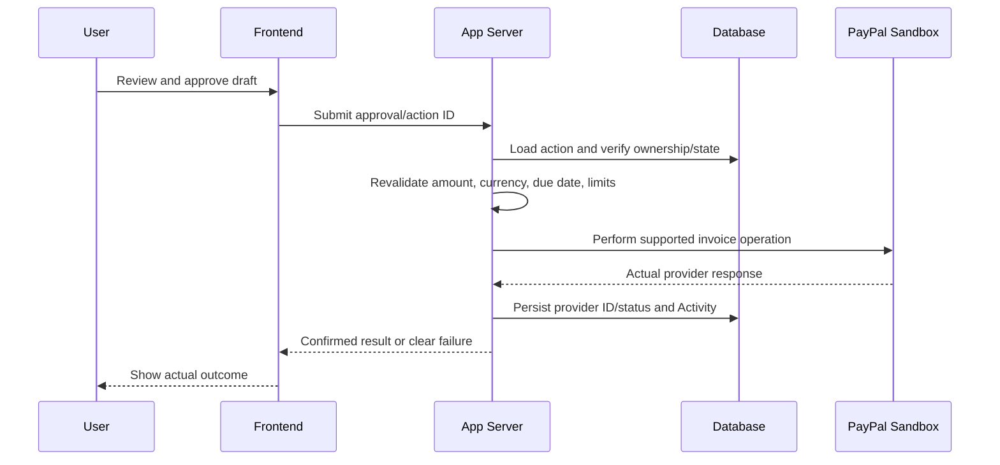

# Architecture

## Status
Proposed architecture pending Stage 0 project inspection. Do not assume the existing project matches this diagram.

## High-level boundaries

## Responsibilities
### Frontend
Screens, accessible forms, agent conversation, approval slip, tables, charts, theme, validation feedback, and calls to application API. No private provider credentials.

### Application server
Authentication/authorization, business validation, invoice/client operations, action state machine, Gemini tool processing, PayPal OAuth/API calls, webhook verification, persistence, activity logging, rate limits, and safe errors.

### External providers
Gemini; PayPal Sandbox; one selected database/auth provider; hosting and scheduler if actually needed.

## Key trust boundaries
- Browser input is untrusted.
- Model output is untrusted until schema-validated and business-validated.
- PayPal responses are provider data and must be checked before updating local state.
- Webhook payloads are untrusted until signature verification passes.
- User-owned records must be authorized on every server operation.

## Critical sequence: approved invoice send

## Architectural decisions to record
- Existing runtime and build tool.
- Database and auth provider (one each unless justified).
- PayPal REST direct integration vs official agent tools/MCP.
- Demo session isolation strategy.
- Hosting target.
- Scheduling strategy for reminders, if implemented.

Record material decisions in `DECISIONS_LOG.md`. Verify current provider docs before relying on endpoints or fields.
