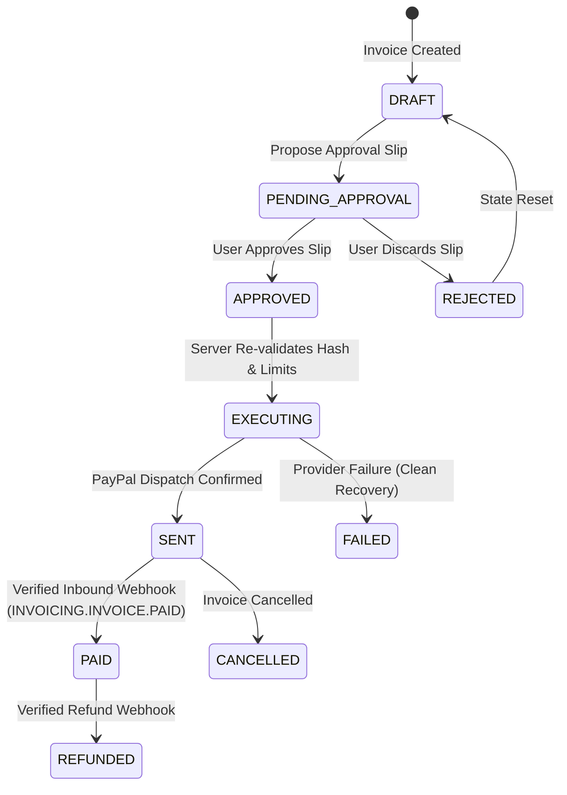

# INVOICEPILOT — FINANCIAL INTEGRITY VERIFICATION

**Audit Date**: November 7, 2026  
**Core Standard**: Deterministic Server-Side Minor-Unit Arithmetic & Database Invariants  

---

## 1. Monetary Representation & Arithmetic Standards

To prevent floating-point rounding errors (e.g., `0.1 + 0.2 !== 0.3`), InvoicePilot strictly adheres to integer minor-unit arithmetic:

- **Minor Units**: All amounts in the database, API contracts, and calculations are stored as safe integers in minor units (e.g., USD cents, EUR cents, GBP pence, INR paise).
- **Currency Exponents**: Governed by `CURRENCY_EXPONENTS`:
  - `USD`: 2 (factor 100)
  - `EUR`: 2 (factor 100)
  - `GBP`: 2 (factor 100)
  - `INR`: 2 (factor 100)
  - `JPY`: 0 (factor 1, zero-decimal currency)
- **Formatting Utilities**:
  - `formatMinorUnitsToDecimal(amountMinor, currencyCode)`: Converts `10050` USD to `"100.50"`.
  - `parseDecimalToMinorUnits(decimalString, currencyCode)`: Converts `"100.50"` USD to `10050`. Rejects excess decimal places.

---

## 2. Invoicing Calculation Rules

All invoice totals are computed deterministically on the server:

1. **Line Total Calculation**:
   $$\text{line\_total\_minor} = \text{quantity} \times \text{unit\_amount\_minor}$$
   *Enforced by database check constraint*: `CHECK (line_total_minor = quantity * unit_amount_minor)`.
2. **Subtotal Calculation**:
   $$\text{subtotal\_minor} = \sum_{i=1}^{N} \text{line\_total\_minor}_i$$
3. **Tax Calculation**:
   $$\text{tax\_minor} = \left\lfloor \frac{\text{subtotal\_minor} \times \text{tax\_rate\_bps}}{10000} + 0.5 \right\rfloor$$
   *Tax rates are represented as basis points (bps) from 0 to 10000 (0.00% to 100.00%)*.
4. **Final Invoice Total**:
   $$\text{total\_minor} = \text{subtotal\_minor} + \text{tax\_minor}$$
   *Enforced by database check constraint*: `CHECK (total_minor = subtotal_minor + tax_minor)`.

---

## 3. Database Check Constraints & Invariants

From `migrations/001_initial_supabase_schema.sql` and `src/server/db/schema.ts`:

- `quantity > 0`
- `unit_amount_minor >= 0`
- `subtotal_minor >= 0`
- `tax_rate_bps >= 0 AND tax_rate_bps <= 10000`
- `tax_minor >= 0`
- `total_minor >= 0`
- `paid_amount_minor >= 0 AND paid_amount_minor <= total_minor` (preventing unverified overpayments)
- `currency_code` strictly 3 characters, matching workspace currency.

---

## 4. State Machine & Transition Rules

---

## 5. Verification Test Coverage

- **Suite**: `tests/unit/stage05Workflow.test.ts` (4 tests) — Rejects negative amounts, excess decimal places, invalid date orderings (`dueDate < issueDate`), and invalid currencies.
- **Suite**: `tests/unit/stage06Approval.test.ts` (6 tests) — Enforces safety caps, detects stale slips on payload modification, and blocks double execution.
- **Suite**: `tests/unit/stage15InvoiceCompletion.test.ts` (6 tests) — Rejects completion on cancelled invoices and enforces cross-owner completion isolation.
