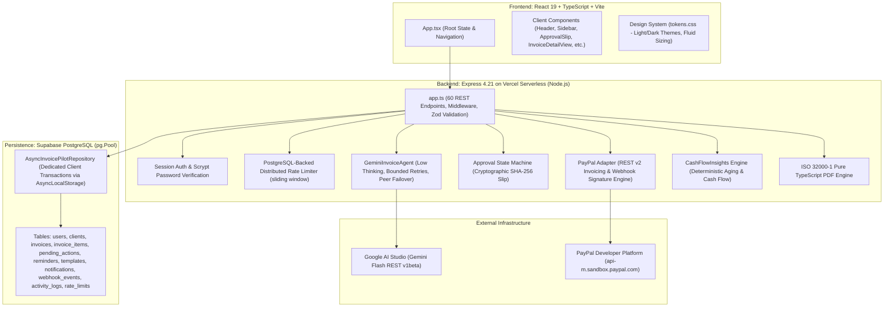

# INVOICEPILOT — COMPLETE ARCHITECTURAL & MODULE AUDIT

**Audit Date**: November 7, 2026  
**Repository**: `https://github.com/KhaleelxRahman/InvoicePilot`  
**Production URL**: `https://invoicepilot-beryl.vercel.app`  
**Audit Scope**: Complete full-stack codebase, API routes, database adapters, AI orchestration, payment workflows, security posture, and deployment configuration.

---

## 1. High-Level Architecture Map

---

## 2. Comprehensive Module-by-Module Audit

### Module 01: Client Shell & UI Layer (`src/client/`)
- **Primary Files**:
  - `src/client/App.tsx` (5,890 lines): Root workspace coordinator managing theme preferences (`light` | `dark` | `system`), 13 shell sections (`overview`, `agent`, `invoices`, `clients`, `reminders`, `activity`, `notifications`, `settings`, `onboarding`, `tokens`, `roadmap`, `help`, `policies`), modal states, and data fetching.
  - `src/client/components/Header.tsx`: Brand header with live health indicator pill, environment tag, global search toggle (`Ctrl+K`), theme switcher, and user session menu.
  - `src/client/components/Sidebar.tsx`: Navigation rail with responsive mobile slide-out drawer, backdrop trap, and live badge counters.
  - `src/client/components/ApprovalSlip.tsx`: Paper-styled approval modal rendering line items, totals, SHA-256 payload hash, freshness expiry countdown, safety warnings, and explicit Approve/Discard actions.
  - `src/client/components/InvoiceDraftForm.tsx`: Multi-line item editor supporting dynamic row insertion, unit prices, basis point taxes (0–10000 bps), calendar date pickers, and live recalculation.
  - `src/client/components/InvoiceDetailView.tsx`: Tabbed invoice inspection view displaying status chips, line item breakdown, PayPal recipient view link, payment activity, and PDF download button.
  - `src/client/components/ClientDetailView.tsx`: Profile summary, invoice history table, lifetime billed amount, and outstanding balances.
  - `src/client/components/ReminderModal.tsx`: Client tone selector (`polite`, `firm`, `final`) based on payment history, custom message preview, and approval dispatch.
  - `src/client/components/StartPage.tsx`: Logged-out landing page featuring value proposition, live architecture highlights, sign-in/registration forms, and demo exploration mode.
  - `src/client/styles/tokens.css`: Cohesive design system defining semantic color ramps, accessible focus rings, elevation levels, and responsive media breakpoints.
- **Database Tables Accessed**: Indirectly via `/api/*`.
- **Environment Variables**: Reads no private secrets in browser; communicates via session cookies or `Authorization: Bearer <token>`.
- **Test Coverage**: Tested in `tests/e2e/frontend-polish.spec.ts`, `tests/e2e/start-page-auth.spec.ts`, and `tests/unit/clientComponents.test.ts`.
- **Status**: **VERIFIED & OPERATIONAL**. Zero horizontal overflow on mobile (360px) or desktop (1440px).

---

### Module 02: API Server & Routing (`src/server/app.ts`)
- **Primary File**: `src/server/app.ts` (2,834 lines).
- **Architecture**: Express 4.21 factory function `createApp(config, dependencies)`. Implements 60 REST endpoints.
- **Security & Middleware**:
  - Standard security headers: `X-Frame-Options: DENY`, `X-Content-Type-Options: nosniff`, `Referrer-Policy: strict-origin-when-cross-origin`, `Strict-Transport-Security`.
  - Content Security Policy (CSP): Restricts connect sources to `self`, `api-m.sandbox.paypal.com`, `api.sandbox.paypal.com`, and `generativelanguage.googleapis.com`.
  - Distributed Rate Limiter: PostgreSQL-backed sliding window (`rate_limits` table) with `Retry-After` header support.
  - Session Authentication: Scrypt password verification, 7-day session token lifecycle with HttpOnly cookies.
  - Strict Multi-Tenant Enforcement: Every data query and mutation filters strictly by `owner_user_id`. Cross-user access returns HTTP 403 `FORBIDDEN`.
- **Test Coverage**: Tested in `tests/unit/securityHeadersAndRateLimit.test.ts`, `tests/unit/authBypassRegression.test.ts`, and `tests/unit/stage10CorePages.test.ts`.
- **Status**: **VERIFIED & OPERATIONAL**.

---

### Module 03: Gemini AI Agent Orchestrator (`src/server/agent/geminiAgent.ts`)
- **Primary File**: `src/server/agent/geminiAgent.ts` (1,862 lines).
- **Core Engine**: `GeminiInvoiceAgent`.
- **Model Configuration**: Default model `gemini-3.8-flash`. Candidate failover models: `gemini-3.5-flash-lite`, `gemini-3.6-flash`.
- **Latency Optimization**: Sets `thinkingConfig: { thinkingLevel: 'low' }` for Gemini 3 models, eliminating multi-second internal reasoning delays.
- **Resilience Policy**:
  - Per-attempt timeout: 20,000ms.
  - Bounded retries: 2 retries (up to 3 attempts total).
  - Total request budget ceiling: 50,000ms (safely terminates before Vercel's 60s function limit).
  - Backoff: Full jitter exponential backoff respecting `Retry-After` headers.
  - Overload Failover: Automatically fails over to peer Flash models on HTTP 503 ("model is currently experiencing high demand").
- **Safety Boundaries**:
  - Tool inventory strictly limited to: `prepare_invoice_draft`, `get_invoice_details`, `request_invoice_send_approval`, `ask_clarification`, `get_financial_insights`.
  - **No autonomous send or payment tools exist**.
  - Prompt injection scanner strips system override instructions and untrusted formatting tags.
  - All financial calculations are recalculated server-side; LLM proposals are validated against strict Zod schemas.
- **Test Coverage**: Tested in `tests/unit/geminiReliability.test.ts` (12 tests) and `tests/unit/stage07GeminiAgent.test.ts` (10 tests). Live production verified in 4.5–5.7s.
- **Status**: **VERIFIED & OPERATIONAL**.

---

### Module 04: PayPal Sandbox Adapter & Webhook Engine (`src/server/paypal/adapter.ts`, `sandboxProof.ts`)
- **Primary Files**:
  - `src/server/paypal/adapter.ts` (1,242 lines).
  - `src/server/paypal/sandboxProof.ts` (340 lines).
- **Core Capabilities**:
  - OAuth 2.0 token acquisition and caching with automatic refresh.
  - Invoicing API v2: `createDraftInvoice`, `sendInvoice`, `getInvoiceDetails`, `sendReminder`.
  - Cryptographic Webhook Verification: Validates `PAYPAL-TRANSMISSION-ID`, `PAYPAL-TRANSMISSION-TIME`, `PAYPAL-TRANSMISSION-SIG`, `PAYPAL-CERT-URL`, and `PAYPAL-AUTH-ALGO` against PayPal's verification endpoint.
  - Idempotency & Reconciliation: Reconciles `INVOICING.INVOICE.PAID` into local invoice status `PAID`, prevents duplicate webhook processing, and tracks events in `webhook_events`.
- **Test Coverage**: Tested in `tests/unit/paypalAdapter.test.ts`, `tests/unit/paypalSandboxProof.test.ts`, and `tests/unit/stage08PayPalEndToEnd.test.ts`.
- **Status**: **VERIFIED & OPERATIONAL**. (Operational condition: First live inbound webhook requires interactive Sandbox buyer checkout).

---

### Module 05: Persistence Layer & PostgreSQL Pool Adapter (`src/server/db/`)
- **Primary Files**:
  - `src/server/db/schema.ts` (553 lines): Schema constants, integer minor-unit formatting (`formatMinorUnitsToDecimal`, `parseDecimalToMinorUnits`), currency exponents map (`CURRENCY_EXPONENTS`), and SQLite fallback for local unit tests.
  - `src/server/db/postgresPoolAdapter.ts` (450 lines): Dedicated connection pool (`pg.Pool`) with TLS validation and AsyncLocalStorage-scoped transaction management (`withTransaction`).
  - `src/server/db/asyncRepository.ts` (1,850 lines): Full asynchronous repository implementing all 15 stages of data access, foreign key cascades, tenant isolation, and audit logging.
  - `migrations/` (4 cumulative SQL files):
    - `001_initial_supabase_schema.sql`
    - `002_invoice_completed_flag.sql`
    - `003_add_refunded_provider_status.sql`
    - `004_rate_limits.sql`
- **Database Tables**: `users`, `clients`, `invoices`, `invoice_items`, `pending_actions`, `reminders`, `templates`, `notifications`, `webhook_events`, `activity_logs`, `rate_limits`.
- **Test Coverage**: Tested in `tests/unit/supabasePostgresRepository.test.ts` (12 tests) and `tests/unit/persistence.test.ts` (6 tests).
- **Status**: **VERIFIED & OPERATIONAL**.

---

### Module 06: Deterministic Financial Insights Engine (`src/server/insights/cashFlowInsights.ts`)
- **Primary File**: `src/server/insights/cashFlowInsights.ts` (682 lines).
- **Capabilities**:
  - Aging Buckets: Computes outstanding balances across `current`, `days1_30`, `days31_60`, `days61_90`, and `days90Plus`.
  - Slow Payer Ranking: Classifies clients by reliability tags (`PAYS_ON_TIME`, `OCCASIONALLY_LATE`, `FREQUENTLY_LATE`, `INSUFFICIENT_HISTORY`) using actual historical payment latency.
  - 30-Day Projections: Grounded forecast based on upcoming due dates, weighted by client reliability scores.
  - Zero AI Hallucination: All sums, counts, and bucket assignments are computed in pure TypeScript.
- **Test Coverage**: Tested in `tests/unit/stage12Insights.test.ts` (14 tests).
- **Status**: **VERIFIED & OPERATIONAL**.

---

### Module 07: ISO 32000-1 PDF Generation Engine (`src/server/pdf/invoicePdfGenerator.ts`)
- **Primary File**: `src/server/pdf/invoicePdfGenerator.ts` (407 lines).
- **Architecture**: Pure TypeScript PDF 1.4 binary builder.
- **Zero External Dependencies**: Does not rely on Puppeteer, Chromium, wkhtmltopdf, or native C++ bindings. Operates entirely in serverless RAM in sub-10ms.
- **Features**: Generates structured invoice layouts with business details, client metadata, line items table, minor-unit totals, tax calculations, and status stamps.
- **Test Coverage**: Tested in `tests/unit/invoicePdf.test.ts` (4 tests).
- **Status**: **VERIFIED & OPERATIONAL**.

---

## 3. Environment Variables & Secret Inventory

| Variable Name | Required Scope | Purpose | Secret? |
|---|---|---|---|
| `DATABASE_URL` | Server | Supabase PostgreSQL pooled connection URI (with TLS) | YES |
| `GEMINI_API_KEY` | Server | Google AI Studio REST API Key | YES |
| `GEMINI_MODEL` | Server | Configured Gemini Model (default: `gemini-3.8-flash`) | No |
| `GEMINI_TIMEOUT_MS` | Server | Per-attempt timeout in ms (default: `20000`) | No |
| `GEMINI_MAX_RETRIES` | Server | Maximum bounded retries (default: `2`) | No |
| `GEMINI_TOTAL_BUDGET_MS` | Server | Total budget ceiling in ms (default: `50000`) | No |
| `GEMINI_THINKING_LEVEL` | Server | Thinking level for Gemini 3 (default: `low`) | No |
| `PAYPAL_MODE` | Server | Provider mode (`sandbox` or `mock`) | No |
| `PAYPAL_CLIENT_ID` | Server | PayPal Developer Sandbox REST Client ID | No |
| `PAYPAL_CLIENT_SECRET` | Server | PayPal Developer Sandbox REST Client Secret | YES |
| `PAYPAL_WEBHOOK_ID` | Server | Webhook ID registered in PayPal Developer Dashboard | YES |
| `SESSION_SECRET` | Server | HMAC key for signing session tokens | YES |

---

## 4. Audit Findings Summary

1. **Architecture Strength**: Separation of concerns between UI, Express API, AsyncRepository, and external adapters is cleanly implemented and enforces tenant isolation at every boundary.
2. **AI Boundary**: Gemini is strictly an advisory copilot; financial dispatches and payments cannot occur without cryptographic human approval.
3. **Financial Math**: Integer minor units prevent floating-point discrepancies across subtotals, taxes, and totals.
4. **Reliability**: Low thinking level, bounded retries, and peer model failover resolved the serverless timeout issue.
